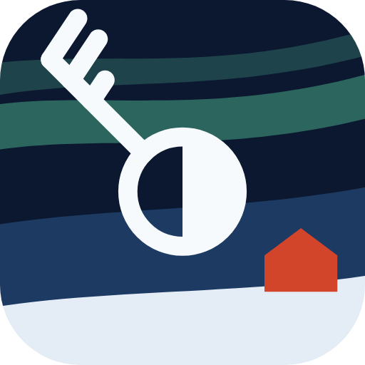
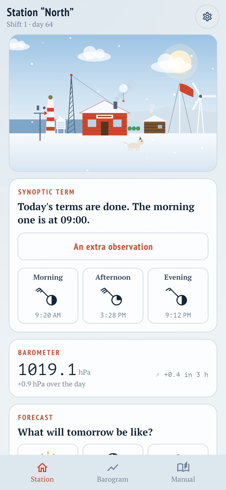
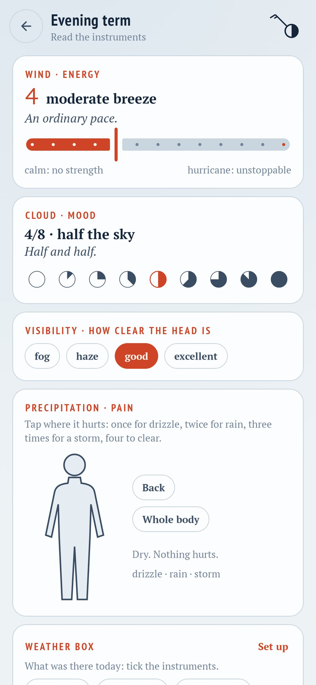
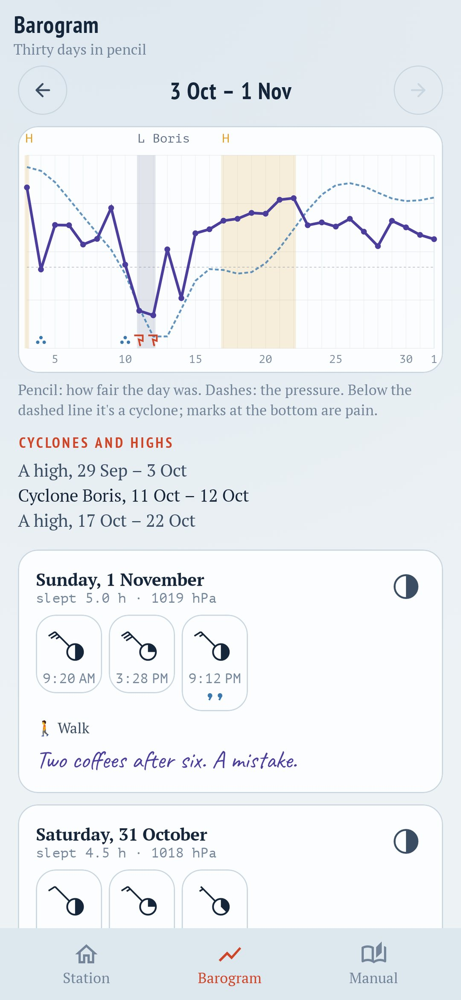
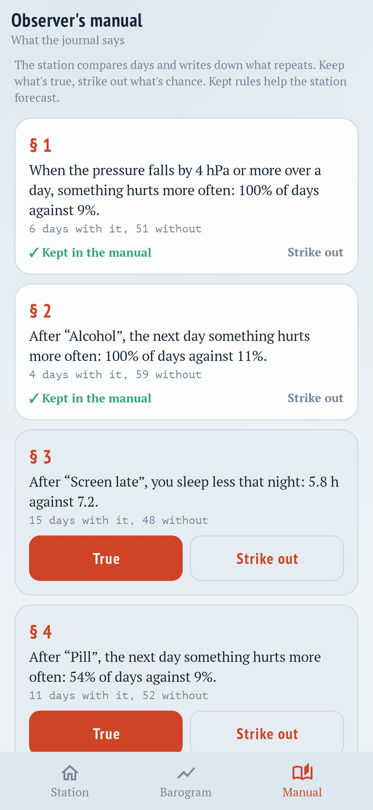

<div align="center">



# Overwinter

### A wellbeing diary kept like a polar station

*You are wintering alone at a polar station, and the station is your body. Three times a day comes a synoptic term: ten seconds to read the instruments and send a report to the mainland. Energy is the wind, mood is the cloud cover, pain is precipitation over a map of the body. Bad spells get names, as cyclones do, and you can see where they ended. The station grows with every term you keep, not with good days. Free, no ads, no internet.*

[](https://github.com/bigdevwhale/overwinter/actions/workflows/android.yml)


[](LICENSE)

**English** · [Русский](README.ru.md) · [Changelog](CHANGELOG.md)

   

**[Download the APK](https://github.com/bigdevwhale/overwinter/releases/latest/download/Overwinter.apk)** · Android 11+

</div>

---

## The synoptic term

The scales are the real meteorologist's, and a term takes about ten seconds.

- **Wind is energy**: the Beaufort scale, from 0 "calm, flat out" to 12 "hurricane, I could move mountains".
- **Cloud is mood**: the sky in eighths, from 0 clear and light to 8 grey with no gaps.
- **Visibility is how clear the head is**: fog, haze, good, excellent.
- **Precipitation is pain**: tap the body where it hurts, once for drizzle, twice for rain, three times for a thunderstorm.
- **Sleep** is asked at the first term of the day.
- **The weather box** holds what you want to watch: coffee, alcohol, workouts, pills, stress, a screen late at night. Add your own.
- **The watch journal**: a line in pencil, if you want one.

The report goes out as a telegram in five-figure groups, as real stations send them, and the telegraph key taps it out in Morse.

## What the station notices

- **The barogram**: thirty days in one pencil line, how fair each day was, the pressure dashed, pain marked below.
- **Named cyclones**: two bad days in a row make a cyclone, and it gets a name. A good spell is a high. When bad weather drags on, it helps to see the last one end.
- **The phone's barometer**: if the phone has one, the station records the pressure every hour and looks for a link with how you feel, such as "when the pressure falls 4 hPa in a day, something hurts more often". It warns you the next time it falls.
- **The observer's manual**: the station compares days with and without each instrument and writes down what repeats. Keep what's true, strike out what's chance.
- **Tomorrow's forecast**: in the evening you call tomorrow, the station calls its own, and the next day shows whose came true.
- **A report for a doctor**: a plain PDF without the polar words: energy, mood, pain by body part, sleep, what you took, every day in a table.

## The wintering

- The station grows with the terms you keep: a weather screen, an anemometer, a flag mast, a radio mast, a wind turbine, Purga the dog, a banya, and on to an icebreaker at the pier.
- Ranks from observer to head of station.
- Rare phenomena: the aurora once a cyclone has passed, a halo on a clear morning, an arctic fox at the window, reindeer tracks when you come back after a break.
- Missed days aren't punished: the station just gets snowed in, and one term digs it out.
- 90-day shifts with a short summary.
- Polar day and polar night themes.

The journal stays on the phone. The app has no internet permission, no account, no ads, no analytics.

## Build

```
./gradlew assembleDebug                      # app.overwinter.dev
./gradlew assembleDebug -Pdemo               # app.overwinter.demo: two months of made-up observations
./gradlew testDebugUnitTest                  # cyclones, rules, the telegram, the journal
./gradlew testDebugUnitTest -Prender --tests '*RenderScreens*' && python tools/shots.py   # screenshots
python tools/res.py                          # strings, EN and RU, from one table
python tools/icon.py                         # the launcher icon and small XML resources
```

Kotlin, Jetpack Compose, DataStore, WorkManager. Fonts: PT Sans Narrow, PT Serif, PT Mono, Caveat (SIL OFL).

Part of [StillCraft](https://bigdevwhale.github.io/stillcraft/). MIT licence.
