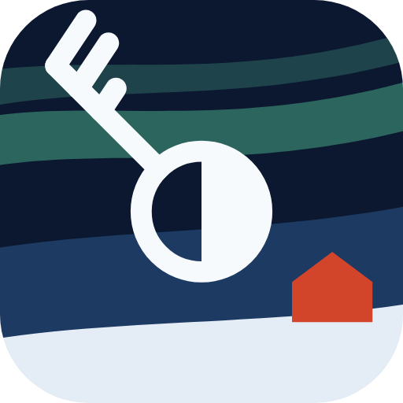
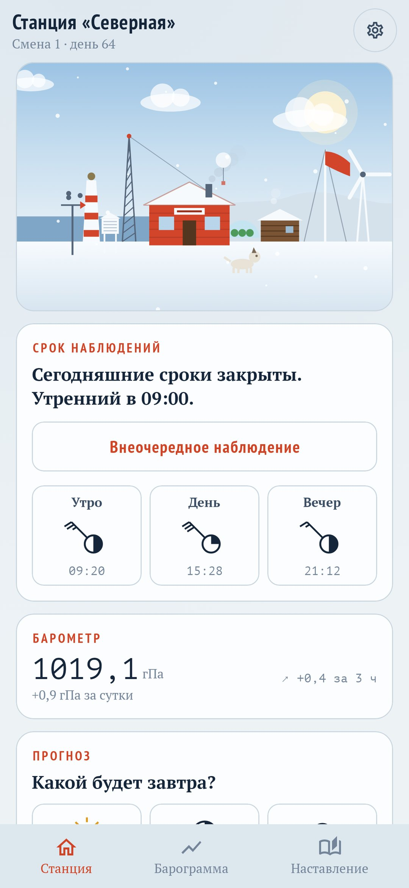
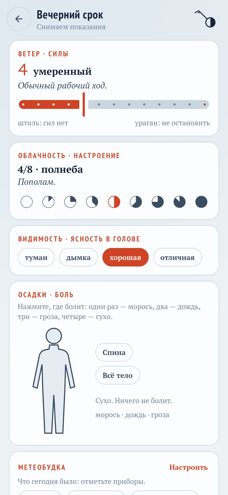
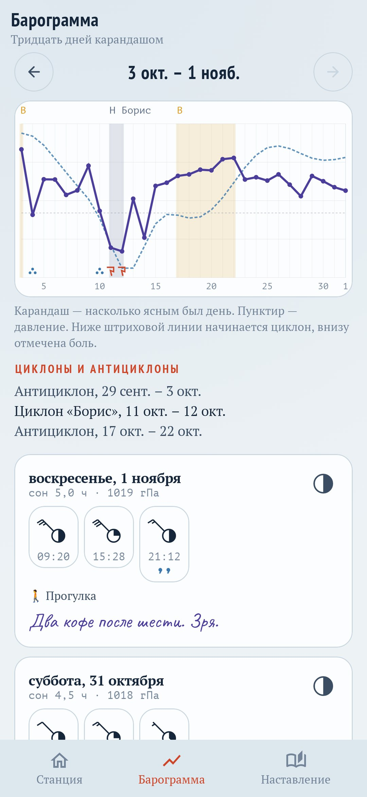
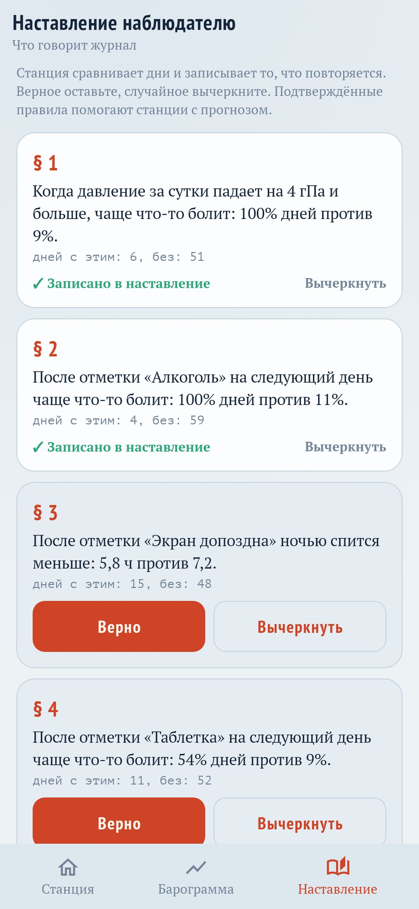

<div align="center">



# Зимовка

### Дневник самочувствия, который ведут как полярную станцию

*Вы один зимуете на полярной станции, и эта станция — ваше тело. Три раза в день наступает срок наблюдений: за десять секунд вы снимаете показания и передаёте сводку на Большую землю. Силы меряются ветром, настроение — облачностью, а боль отмечается осадками на карте тела. Плохие полосы получают имена, как циклоны, и потом видно, когда они закончились. Станция растёт от каждого срока, а не от хороших дней. Бесплатно, без рекламы и без интернета.*

[](https://github.com/bigdevwhale/overwinter/actions/workflows/android.yml)


[](LICENSE)

[English](README.md) · **Русский** · [Изменения](CHANGELOG.md)

   

**[Скачать APK](https://github.com/bigdevwhale/overwinter/releases/latest/download/Overwinter.apk)** · Android 11+

</div>

---

## Срок наблюдений

Шкалы взяты у настоящих метеорологов, и на запись уходит секунд десять.

- **Ветер — это силы.** Шкала Бофорта от 0 до 12: от «штиль, лежу пластом» до «ураган, горы сверну».
- **Облачность — это настроение.** Небо в восьмых долях: 0 — ясно и легко, 8 — всё серое, просветов нет.
- **Видимость — это ясность в голове:** туман, дымка, хорошая или отличная.
- **Осадки — это боль.** Нажмите на силуэт, где болит: один раз — морось, два — дождь, три — гроза.
- **Сон** записывается на первом сроке дня.
- **Метеобудка** — то, за чем хочется следить: кофе, алкоголь, тренировки, таблетки, стресс, экран допоздна. Можно добавить свои приборы.
- **Вахтенный журнал** — строчка от руки, если хочется.

Сводка уходит телеграммой из пятизначных групп, как у настоящих станций, а телеграфный ключ отстукивает её морзянкой.

## Что станция замечает

- **Барограмма.** Тридцать дней одной линией: насколько ясным был каждый день, давление пунктиром, внизу отметки боли.
- **Циклоны с именами.** Два плохих дня подряд — это циклон, и ему дают имя: «Агата», «Борис», «Вера». Хорошая полоса становится антициклоном. Когда непогода тянется долго, полезно видеть, что прошлая тоже закончилась.
- **Барометр телефона.** Если в телефоне есть датчик давления, станция записывает его раз в час и ищет связь с самочувствием. Например: «Когда давление за сутки падает на 4 гПа и больше, чаще болит голова». Когда давление снова начнёт падать, станция предупредит заранее.
- **Наставление наблюдателю.** Станция сравнивает дни с прибором и без него и записывает то, что повторяется: «После отметки «Кофе» ночью спится меньше». Верное вы оставляете, случайное вычёркиваете.
- **Прогноз на завтра.** Вечером вы даёте прогноз, станция даёт свой, а на следующий день видно, чей оправдался.
- **Сводка для врача.** Обычный PDF без полярных слов: силы, настроение, боль по частям тела, сон, что принимали, и все дни таблицей.

## Зимовка

- Станция строится от сроков: метеобудка, флюгер, мачта с флагом, радиомачта, ветряк, собака Пурга, баня и дальше, до ледокола у причала.
- Звания: от наблюдателя до начальника станции.
- Редкие явления: северное сияние после того, как прошёл циклон, гало ясным утром, песец у окна, следы оленей, если вернуться после перерыва.
- Пропуски не наказываются. Станцию просто заметает снегом, а один срок её откапывает.
- Смены по 90 дней с короткими итогами.
- Две темы: полярный день и полярная ночь.

Журнал хранится только на телефоне. Разрешения на интернет у приложения нет, а аккаунтов, рекламы и аналитики тоже нет.

## Сборка

```
./gradlew assembleDebug                      # app.overwinter.dev
./gradlew assembleDebug -Pdemo               # app.overwinter.demo: два месяца выдуманных наблюдений
./gradlew testDebugUnitTest                  # циклоны, правила, телеграмма, журнал
./gradlew testDebugUnitTest -Prender --tests '*RenderScreens*' && python tools/shots.py   # скриншоты
python tools/res.py                          # строки EN и RU из одной таблицы
python tools/icon.py                         # иконка и мелкие XML-ресурсы
```

Kotlin, Jetpack Compose, DataStore, WorkManager. Шрифты: PT Sans Narrow, PT Serif, PT Mono, Caveat (SIL OFL).

Часть [StillCraft](https://bigdevwhale.github.io/stillcraft/). Лицензия MIT.
